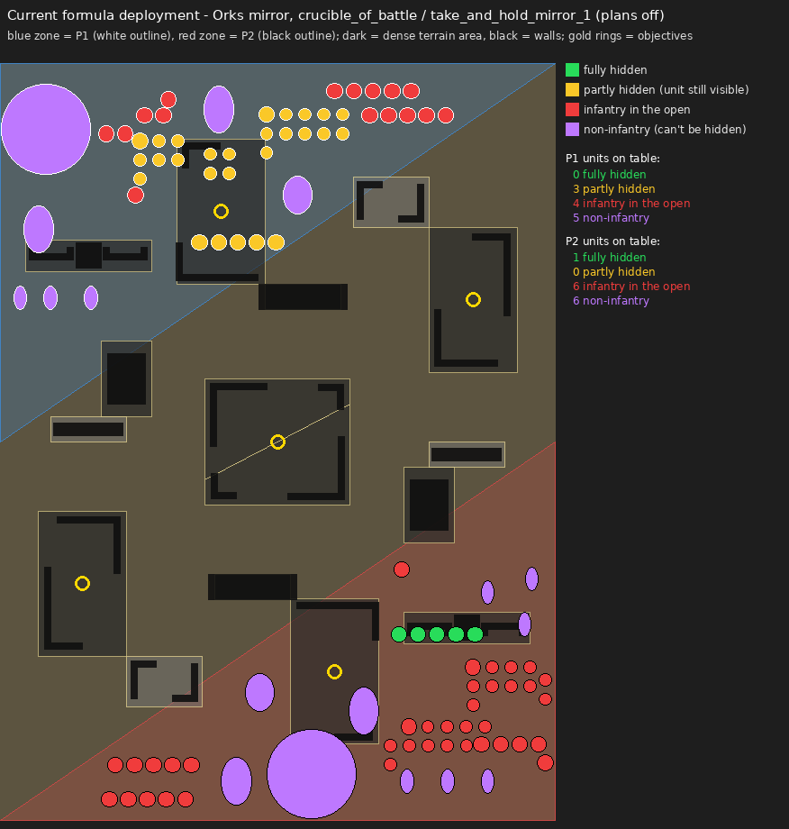
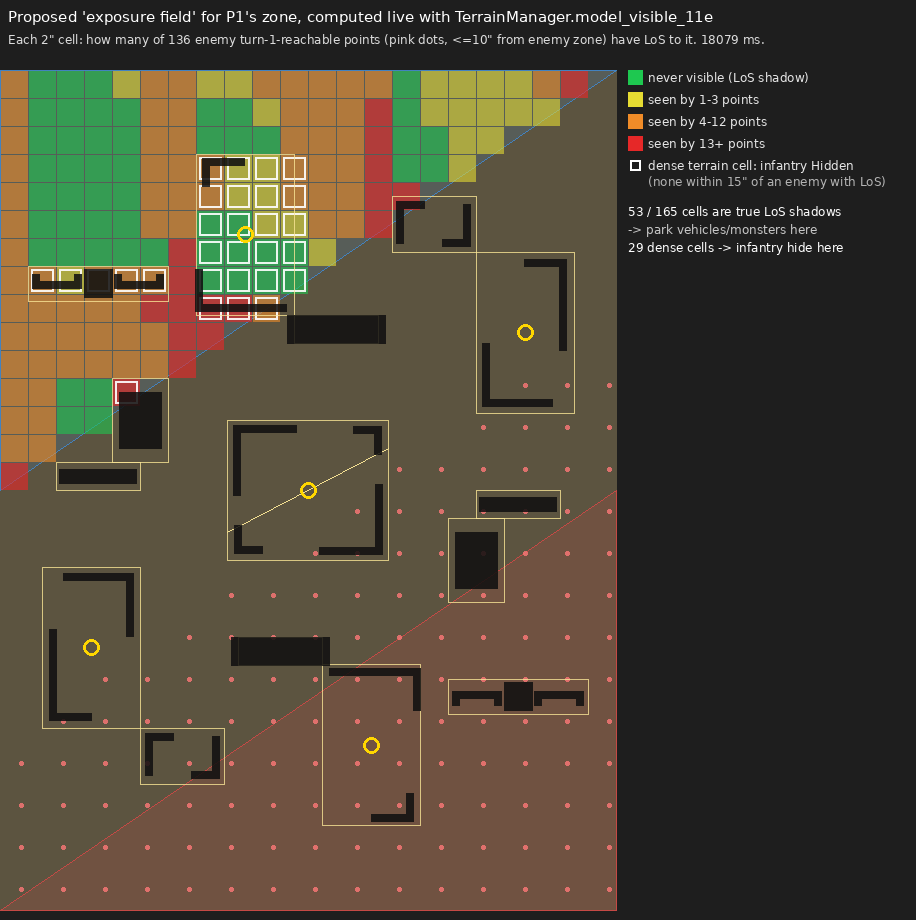

# AI Deployment — how it works today, how it should work (11e), and the build plan

Date: 2026-11-07 · Scope: AI deployment + a human "deployment coach" · Status: proposal, nothing implemented yet
Evidence: `docs/ai_deployment_evidence/` (live screenshots, live-data maps, raw measurements, probe scripts)

---

## 0. TL;DR

- **Today:** units go down in army-list order. Each is placed on a **column grid hugging the *front* edge**, nudged 30% toward the nearest objective, shifted sideways by counter-deployment, then pulled toward "good terrain" scored with **10e-era terrain types**. Nothing in deployment knows the 11e **Hidden / Obscuring / Solid** rules, enemy movement, line of sight, or that the **first-turn roll-off happens *after* deployment**.
- **Measured live (this session, `take_and_hold_mirror_1` / Crucible of Battle):**
  - Multi-model infantry units fully Hidden at the end of deployment: **0 of 8** (Custodes, formula) · **0 of 6 and 1 of 6** (Ork mirror, formula on both sides).
  - "Leakers" — infantry partly in a ruin, so the unit stays targetable: **6 of 8** multi-model Custodes units.
  - **9 Ork units (1,100 pts) were dumped into Strategic Reserves** because the formation generator produced illegal placements (oval bike bases overlapping, coherency, walls). These were never a reserves decision.
  - The same pattern holds on a second map (Hammer & Anvil zones, Custodes mirror): 3/8 and 0/8 fully Hidden, with 4 and 6 leakers.
- **Core idea of the fix — "Stage → Strike":** for every unit, first decide **where it wants to be on turn 1–2** (its *job destination*). Then deploy it at the **safest legal staging spot that can still reach that destination in one move**.
  - "Safest" is measured against **where the enemy can be after *their* first move**, not where they stand now.
  - The score is the expected value across **both turn orders**.
  - Infantry go **wholly inside dense terrain** (Hidden ⇒ only visible within 15").
  - Vehicles and monsters go into **LoS shadows** with clear exit lanes.
  - Screens cover 8" deep-strike holes and charge corridors.
- **Feasibility checked live:** an exposure field over a whole deployment zone is 165 cells × 136 enemy-reachable points.
  - With the engine's `TerrainManager.model_visible_11e` (~0.8 ms per check) it took **18 s**.
  - With the existing fast line test in `VisionMapOverlay._line_blocked_11e_fast` it took **157 ms** (7 µs per line). A 9-point version projects to ≈1.4 s.
  - Offline per-layout tables are a further option: there are only 45 official layouts.
  - Result on this board: **53/165 cells are true LoS shadows** from every turn-1-reachable enemy point.
  - **All 29 dense cells keep infantry Hidden.** The formula only half-used them, leaving units with a few models inside and the rest outside.
- **Build order:**
  - P0: fix legality, the 11e terrain-scorer bugs and metrics.
  - P1: battlefield read.
  - P2: jobs + scorer.
  - P3: army-level slot allocation, posture and drop order.
  - P4: threat model and counter-deployment.
  - P5: reserves, Infiltrators and Scouts.
  - P6: human coach UI.
  - P7: tuning and rollout behind a flag, measured with the existing A/A-anchor + seat-swap protocol.




---

## 1. How the AI deploys today

### 1.1 Pre-game pipeline (engine)

| Step | Who / how | Code |
|---|---|---|
| FORMATIONS | P1 then P2 declare leader attachments → embarks → reserves → warlord. This happens **before** attacker/defender is known, and declared reserves are visible to the opponent. | `FormationsPhase.gd`; AI `_decide_formations` `AIDecisionMaker.gd:4206`, `_evaluate_reserves_declarations` :4737, `_score_unit_for_reserves` :4905 |
| ROLL_OFF | The winner picks deploy-first (Defender) or deploy-second (Attacker). **The AI always picks second.** | `RollOffPhase.gd:197-222`; AIDM :6258 |
| DEPLOYMENT | The Defender places first; sides **alternate one unit at a time**. When one side runs out, the other places everything left. Attached characters and transports come along automatically. TITANIC ⇒ that player skips their next drop. | `TurnManager.gd:104-250`; `DeploymentPhase.gd:722-810` |
| REDEPLOYMENT | P1 first. The AI skips. | `RedeploymentPhase.gd:32`; AIDM `_decide_redeployment` :5799 |
| FIRST_TURN_ROLLOFF | Both roll a D6; the winner takes turn 1 with no choice. **The AI cannot know the turn order while deploying.** `GameState.get_first_turn_player()` silently returns 1 while unset (a trap). | `FirstTurnRollOffPhase.gd:139`; `GameState.gd:1249` |
| SCOUT | The first-turn player resolves all of their Scouts first. Reserve Scouts can be set up in the zone (`SCOUT_RESERVES_DEPLOY`). | `ScoutPhase.gd:36, 830`; AI `_decide_scout` :5831 |

### 1.2 The formula path (`_decide_deployment`, `AIDecisionMaker.gd:5055`)

1. **Unit order:** a plan's order if one matches, otherwise **army-list order**. The order is never ranked (`_build_deploy_order` :5035 says so).
2. **Role** (`_classify_deployment_role` :5353): one of character, melee, anti_tank (S≥9 or AP≥3), fragile_shooter, durable_shooter or general.
   - Gretchin are classed as "melee"; Warbikers as "durable_shooter".
   - There is no screen, backfield or objective-holder role. (`_is_screening_candidate` :14911 exists but deployment never uses it.)
3. **Baseline spot:** a 3–5 column grid across the zone's bounding rectangle. Row 1 sits **2" behind the front edge** and later rows step back. The X position is blended 70/30 with the nearest objective.
4. **Counter-deployment** (`_apply_counter_deployment` :5421): X-shifts of 15–35% toward or away from enemy centroids by role, plus Y nudges of about 1".
5. **Terrain pull** (`_find_terrain_aware_position` :5656, `_score_terrain_for_role` :5594):
   - Candidates are generated *around* each terrain piece's centre ("behind" means only "further from the enemy in Y").
   - They are never *inside* a ruin, except for "woods/crater" types that 11e layouts never use.
   - Each candidate is scored by `type`/`height_category`.
   - It must beat a flat 1.0 or the baseline is used.
6. **Formation:** a 5-wide grid at base diameter + 10 px spacing (`_generate_formation_positions` :24548). Circular-base assumption, rotation 0.
7. **Repair:** collisions are clamped to the **rectangle** (`_resolve_formation_collisions` :24735), then wall checks, then a 40-sample polygon reseat (`_find_in_zone_formation` :24883).
8. **On rejection:** `AIPlayer._handle_failed_deployment` makes 5 tries × 20 random wall-free centres. Then `_fallback_to_reserves` puts the unit in Strategic Reserves, **and can bypass the 50% cap** via `stuck_unit_fallback` (`AIPlayer.gd:3855-4013`, `DeploymentPhase.gd:441`).
9. **Plans** (`_plan_deployment_action` :926): three shipped, all Orks and all layout-bound (`data/ai_plans/*.json`). They place fixed per-model coordinates, mirrored for seat 2, and fall back to the formula.
   - The plan playbook's own finding: fixed placements lose the formula's only real strength — reactivity. Custodes lost with every plan variant.

### 1.3 Measured baseline (live game, 2026-11-07)

Method:
- Run each predeploy fixture with AI vs AI and pause right after DEPLOYMENT.
- Measure per unit with the engine's own functions (`TerrainManager.is_model_hidden`, `model_visible_11e`, `hidden_model_visible_to`).
- Probes are in `docs/ai_deployment_evidence/probes/`, raw rows in `*.json`.

| Run | Side | On table | Infantry units | Fully Hidden | Partly hidden ("leakers") | In the open | Reserves (of which **forced** by failed placement) |
|---|---|---|---|---|---|---|---|
| asym (Custodes formula vs Ork plan) | P1 formula | 11 | 11 | 2 (both 1-model chars) | **6** | 3 | 0 |
| | P2 Ork plan | 12 | 5 | 0 | 2 | 3 | 5 (1 forced) |
| Ork mirror, plans OFF | P1 formula | 12 | 7 | **0** | 3 | 4 | **5 forced (580 pts)** |
| | P2 formula | 13 | 7 | 1 | 0 | 6 | **4 forced (520 pts)** |
| Custodes mirror, plans OFF, **Hammer & Anvil zones** (same terrain layout) | P1 formula | 11 | 11 | 3 of 8 multi-model | 4 | 1 (+ 2 chars) | 0 |
| | P2 formula | 11 | 11 | **0 of 8** multi-model | **6** | 2 (+ 1 char) | 0 |

Hammer & Anvil detail:
- Front units sit 24.9–25.5" from the enemy zone, i.e. right on the front edge of an 18"-deep zone with a 24" gap.
- 4–5 units per side were already visible to ≥1 deployed enemy unit before anyone moved.
- No forced reserves here: Custodes are all round-based infantry.

Further observations:
- The mirror run logged **14 rejected DEPLOY_UNIT attempts**. Causes: oval Warbiker/Deffkopta bases overlapping inside the grid, 9" coherency envelope breaks, overlapping walls, and "not wholly within zone" on the triangular map.
- Exposure field for P1's zone, probing visibility from every point the enemy can reach on turn 1 (≤10" from their zone):
  - 53/165 two-inch cells are never visible.
  - 77/165 are seen by ≤3 of 136 points.
  - All 29 dense cells keep infantry Hidden.
  - Safe space exists; the formula just doesn't look for it.

### 1.4 Gaps, ranked by impact

| # | Gap | Evidence | Impact |
|---|---|---|---|
| G1 | Illegal formations cause **forced reserves**, even past the 50% cap | 9 units in one game; `stuck_unit_fallback` | Huge. A third of the army arrives R2+ or is destroyed at the end of R3. The 50% rule is broken. |
| G2 | **No 11e visibility model** in deployment. Candidates are placed *next to* ruins instead of *inside* dense areas, so leakers are common. | Multi-model units fully Hidden: 0/8 (Custodes), 0/6 and 1/6 (Ork mirror); 6/8 Custodes units leak | Gives the enemy's turn 1 free targets. |
| G3 | **Deploys at the front edge by default** (row 1 = 2" from front) | `_decide_deployment` deploy_y | Maximises turn-1 charge and shooting exposure. |
| G4 | Ignores the **turn-order uncertainty** (roll-off happens after deployment) | §1.1 | Deploys as if it will move first. |
| G5 | No **enemy reach model**: threat = centroid + max range, Euclidean, current positions only. Charge reach adds +2" engagement range, which 11e doesn't grant. | `_calculate_enemy_threat_data` :28695 | Exposure is misjudged both ways. |
| G6 | 11e terrain scorer bugs | Explore audit | Wrong spots, systematically. |
| G7 | No **job / destination** concept; unit order is army-list order; no army-level plan | :5035, review doc §3.1 | Units don't stage for turn 1–2; scarce hidden spots are taken first-come, first-served. |
| G8 | Formation shapes: one 5-wide grid, circular bases | :24548 | Can't fill a ruin footprint, form a screen line, or fit a lane. |
| G9 | No **Infiltrators** logic; Scouts move in a straight line, use 9" not 8", have no Hidden/LoS awareness, and reserve Scouts are skipped | AIDM :5831-6125, :5899 | Forward units are wasted or exposed. |
| G10 | Reserves are chosen without a deployment-capacity view; arrival placement uses 9" not 8" | :4737, :8073 | Reserves end up a dumping ground, not a plan. |
| G11 | No screens or deep-strike denial at deployment (these exist only in movement) | :14929, :28452 | Backfield holes and naked characters. |

Details for G6:
- Every 11e piece is type "ruins", so everything "grants cover" and every tall/medium piece "blocks LoS".
- Candidates are generated from wall *features* as well as areas.
- The fragile_shooter cover and LoS weights are swapped (:5617-5620).
- anti_tank has no scoring branch.
- `is_top_zone` (:5189) is true for both players on Dawn of War and Sweeping Engagement, because both zones touch y=0, so "front" is wrong on 2 of the 6 maps.

---

## 2. The rules that shape deployment (11e core rules, cross-checked against the engine)

Rules text: `docs/rules/40k_11th_edition_core_rules.txt`. Engine constants: `scripts/rules/GameConstants.gd`.

| Rule | Ref | What it means for deployment |
|---|---|---|
| **Turn order is rolled after deployment** | engine `FIRST_TURN_ROLLOFF` | Every placement must survive "they go first" (p = 0.5). Score both branches. |
| **Hidden**: INFANTRY/BEASTS/SWARM model *within* (any part of its base) a terrain area containing a dense feature, whose unit hasn't shot this turn or last ⇒ visible only within **15"** detection range. Gone to Ground: −3" when sight crosses dense; floor 9". | 13.09; TM:999-1080 | At deployment nobody has shot, so **every model** of an infantry unit inside dense terrain is untargetable from >15" (12" behind dense). **One model outside ⇒ the unit is targetable.** |
| **Obscuring**: a line crossing any light/dense terrain area that neither model is within is blocked | 13.10 | Boards are LoS-poor. Danger comes from where enemies can *move to*, including stepping *into* the blocking area, which removes it from the check. |
| **Solid**: dense features block LoS through gaps ≤3" above ground | 13.11 | Units inside a ruin see out only through open sides. Ground-floor "windows" don't count. |
| **Benefit of Cover**: −1 BS if every model is infantry-type within a terrain area, or not fully visible due to terrain | 13.08 | Even shootable units in ruins take fewer hits. Engine approximation: model centre inside a piece (TM:1380). |
| **Indirect fire** can target non-visible units, but always gives the target cover and hits only on 6s (4+ if the firer stayed stationary *and* a friendly unit can see the target) | 10.07 | Hidden units are not immune, but are ~3× harder to hit. Spotters matter. |
| **Plunging Fire**: +1 BS from terrain 3"+ high at ground-level targets, or TOWERING within 12" | 22.05 | The engine never writes `elevation_inches`, so upper-floor deployment isn't possible yet (future hook). |
| **Terrain objectives**: holding = being *within* the objective's terrain area | 14.01 | Home and most NML objectives are ruins, so holders can be **Hidden while holding**. |
| **Movement through dense terrain**: infantry/beasts/swarm/mobile pass horizontally; others can't cross dense sections >2" high | 13.06 | Vehicles and monsters get **boxed in**. Deploy them with exit lanes. |
| Advance = M + D6; no charge after advancing. Charge: declared within 12"; after the 2D6 roll, targets must be **within the roll, base to base** (engagement range does not extend it) | 09.06, 11.02, 11.04; engine `ChargePhase.gd:862` | Turn-1 melee reach = M + 2D6. At 58% (needs 7): M6 → 13", M12 → 19". Hard ceiling M + 12". |
| Fire Overwatch (snap shooting): 1 visible target within 24", hits on 6s | 15.08–15.09 | Minor deployment factor. |
| **Strategic reserves**: ≤50% points; arrive R2+ via ingress wholly within 6" of an edge and >8" from enemies; not in the enemy zone before R3; **destroyed at end of R3** if not arrived. Deep Strike: anywhere >8". Rapid Ingress (1CP, not R1). | 20.01–20.04, 24.09, 15.07 | Reserves are a real "hide" for units the board can't protect, but a timed one. Screens must deny 8" holes by R2. |
| **Infiltrators**: set up anywhere >8" from the enemy zone and all enemy units | 24.20 | Forward objective grabs, forward screens, and pushing enemy infiltrators back (8" both ways). |
| **Scouts X"**: after deployment (and after the first-turn roll), move ≤X" ending >8" from enemies; or, from reserves, set up wholly in your zone | 24.31–24.32 | A **late drop with full information, including turn order.** Very strong for the AI. |
| Coherency: 2" to one model **and** 9" to every model | 03.03; `coherency_envelope_inches()=9` | Screens can't be long thin lines. A 10-model chain is ≈9" max. |
| Deadly Demise X: 6" mortal wounds on death | 24.08 | Don't park fragile units within 6" of your own likely-to-die vehicles. |
| Lone Operative (visible only within 12"/X") | 24.24 | These characters can stand anywhere outside 12". Engine note: `_check_target_visibility` doesn't apply it. |

Map geometry (`res://deployment_zones/*.json`, 44×60"):

Minimum zone-to-zone gap, computed from the polygons:

| Map | Zones | Min gap |
|---|---|---|
| Hammer & Anvil | 18"-deep short-edge strips | 24.0" |
| Dawn of War | 12"-deep long-edge strips | 20.0" |
| Crucible of Battle | Triangles | 24.8" |
| Tipping Point | Stepped, 12–20" deep | 20.0" |
| Sweeping Engagement | Stepped long-edge | 16.0" |
| Search & Destroy | Quarter-arcs | 12.7" |

At a 20" gap, an M12 unit starting on its own zone edge needs an 8" roll to hit your front edge on turn 1 (42%). On Search & Destroy, M6 infantry need a 7 at the zone tips (58%). Front-edge deployment is never neutral.

---

## 3. Deployment doctrine (research synthesis)

Tags:
- [11e] = source from the 11th-edition era (Apr–Nov 2026).
- [10e] = 10th-edition source.
- [gen] = edition-agnostic or older.
- [derived] = arithmetic on the 11e rules above.

Caveat: Tabletop Battles (formerly Goonhammer) pages could not be fetched; points marked "(ext.)" come from search extracts. Full source list is in Appendix B.

### 3.1 What 11e changed about deploying
- **Infantry can stand on the line now.** INFANTRY in a terrain area can sit at the front of the zone with LoS into no-man's-land and stay untargetable beyond 15" until they shoot. GW: "deploy your models a lot more freely without worrying about a first-turn barrage" [11e, WarCom terrain].
  - Hidden is checked **per model**: "half-an-inch out of the footprint, you aren't Hidden" [11e, FLG footprints; TTB Hidden (ext.)].
- **Alpha strikes matter less.** The first-player win rate is ≈51% in 11e [11e, 40k-analytics (ext.)]. Siegler credits "Dense deployment protection, Hidden… plus improved cover" for fewer turn-1 alpha strikes and fights pulled toward the middle [11e, FLG].
  - ⇒ Deploy so you survive going second, but **don't give up turn-1 staging** just to avoid an alpha.
- **Vehicles and monsters still use the old logic.** They can't be Hidden, and get no cover from an area they stand *in*: obscuring ignores areas either model is within.
  - ⇒ Keep them **outside terrain areas, directly behind them**. Long thin footprints still hide a tank parked right behind [11e, TTB visibility (ext.); WarCom terrain].
  - A shooter only needs to be *within* an area (not wholly) to ignore its obscuring, so any enemy that can **toe into** the intervening ruin on turn 1 sees through it. Observer sampling must include those spots [11e, TTB terrain (ext.)].
- **Screening is harder.**
  - 9" coherency + 8" arrival distance means one unit seals only ≈25" of a line (9" + 2×8") [derived]. A 60" edge needs ≥3 units, a 44" edge ≥2 [derived].
  - Enemies may move *through* engagement range in the Movement phase, so only gaps narrower than their base actually body-block [11e, WarCom combat].
  - Pile-in and consolidate are 3", and Overrun adds a second pile-in, so keep protected units **≥6" behind** screens [derived].
- **Deep-strike charges are bad.** You must land >8" away, and the target must be within the 2D6 roll (base to base), so the charge needs a 9: 28%, or 48% with a re-roll [11e, WarCom combat; TTB Hammer of Math (ext.)]. Ingress also stops further moves until the Charge phase.
  - ⇒ Melee belongs in reserves only with charge buffs, or as late backfield hunters.
- **Reserves:** one 50% pool; Rapid Ingress not in round 1. "Reserving too much is the common mistake"; 50% is "almost never" right. Only reserve units with a round-2/3 job; keep on-table OC for your home objectives [11e, Grimslate].
- **Turn-1 scoring exists in some pairings.** Examples: 13–15 primary on turn 1 in Priority Assets reports [11e, FLG War in the Caribbean; TTB (ext.)]; locally, Battlefield Dominance scores R1–2 and Outmanoeuvre scores R1.
  - ⇒ If you might go first, stage scorers **one move from expansion/central objectives**, still Hidden or obscured.
- **Fight order:** chargers fight first and the active player picks first. Defensive counter-punch placement is worth less; counter-chargers act on your own turn [11e, WarCom combat].
- **Missions shape the posture:**
  - Take and Hold: many high-OC bodies drip-fed to the centre.
  - Purge the Foe: durable bricks, kill lanes, and *avoid giving up free kills*.
  - Reconnaissance: four-quarter spread outside 6" of the centre.
  - Disruption / Priority Assets: action units and Infiltrators; turn-1 actions score heavily.
  - [11e, TTB disposition reviews (ext.)]
  - Each disposition has 5 missions × 3 recommended layouts, so **deployments can be precomputed per pairing** [11e, WarCom missions; 40 Carrot].
- **Hidden rule details to verify:**
  - The Rules Commentary/app reportedly extends Hidden to Light-only areas, and Gone to Ground needs only partial occlusion by a Solid feature [11e, TTB Hidden (ext.), unverified]. The engine follows the printed text (dense only) — keep a config flag.
  - Detection modifiers are clamped 9"–30" (engine: floor 9" only).
  - Per-army detection modifiers (e.g. Tau +3"/+9", SM "Nowhere to Hide" +3", Custodes +3") belong in the enemy reach model.

### 3.2 Doctrine by topic
- **Turn order unknown ⇒ deploy as if second, but not purely reactively** [10e, Art of Caesura; gen, Fighting Tigers]. Going second: "deny them a first-turn kill", then flip objectives. Keep killable units off central objectives when the opponent's mission pays for kills there [11e, FLG].
- **Drops:**
  - Deploy the least important and least revealing units first. Your most threatening unit dropped first tells the opponent how to deploy [gen, Grimhammer (ext.)].
  - The last drops have "perfect information" [gen, Turn Zero (ext.)].
  - Keep a written deployment order [10e, 40k Unorthodoxy].
  - When deploying first, **leave a hole for big footprints** you'll drop late [10e, Art of Caesura].
  - **If both sides have Infiltrators, be the Defender** (deploy first) to claim forward spots; otherwise take the second drop for information [10e, 40k Unorthodoxy; Art of Caesura].
  - Bait: put a unit where the opponent will want to spend activations, then counter [10e, Art of Caesura].
- **Infiltrators and Scouts:** cut off enemy infiltrate *and* scout moves whenever you can [10e, 40k Unorthodoxy]. In 11e: 8" bubbles over the forward ruins enemy infiltrators would use as Hidden staging [derived]. Infiltrators can't also Scout [11e, TTB (ext.)].
- **Movement planning:**
  - Mark staging areas, yours and theirs; maps are symmetric, so take theirs first [10e, Art of Caesura].
  - Measure the **whole route**, not just the destination, for turns 1–2 [10e, Art of Caesura; 11e, 40 Carrot].
  - Reach the enemy zone by turn 2 at the latest; prioritise the natural expansion objective and the centre [10e, 40k Unorthodoxy].
  - Don't wait for turn 5: there is a 15 VP/round cap [11e, TTB Take and Hold (ext.)].
- **Assault:**
  - "Assault units need to be able to assault": forward, not behind the army [10e, 40k Unorthodoxy; gen, Fighting Tigers].
  - The charge is rolled before targets are chosen, so stage where **≥2 enemy units fall within M + 2D6** and a short roll still has a target [11e, TTB Hammer of Math (ext.)].
  - Charges don't need LoS, so finish moves behind blockers [10e, WarCom tactica].
  - BoLS worries that Hidden over-rewards assault armies staging right behind their line — exactly the Stage→Strike pattern [11e, BoLS].
- **Shooting:**
  - Fire lanes over open ground and NML objectives. Purge the Foe's 6-objective maps split the centre and block long lanes [11e, WarCom July update].
  - Dawn of War allows "very easy flank attacks" from shooters [11e, FLG].
  - Deploy [HEAVY] units already on their firing posts (+1 to hit if moved ≤3") [11e, S&B].
  - The Solid ground floor blocks LoS in and out; upper floors see out. Plunging Fire gives +1 BS from 3"+ and cancels cover [11e, WarCom terrain; S&B]. The engine can't place models on upper floors yet.
  - Firing gives up Hidden through the opponent's next turn, so *who fires first* is a decision [11e].
  - An **Overwatch picket** (24" LoS over the enemy's approach lanes) has small value but loses Hidden when it fires [11e, TTB (ext.)].
- **Characters and fragile units:**
  - Wholly inside dense, on the **far side**, partly behind a Solid feature (Gone to Ground → 12") [11e, WarCom; TTB].
  - Screen them "from every angle", aircraft included [gen, TTB screening (ext.)].
  - Plan where they relocate on turn 1, before deep-strike threats go live [gen, Goonhammer (ext.)].
- **Backfield:**
  - Put a cheap unit on home against deep strikers [11e, FLG].
  - The 10e "≈9" in from the zone corners" became 8" [10e→derived].
  - How much home matters depends on the matchup: Take and Hold, Defend Stronghold, and Priority Assets' 10 VP for your home at game end [11e, TTB/FLG].
  - Hold from the far edge of the objective area, with a body in front [10e→derived].
- **Transports:**
  - Dedicated transports must start with a unit embarked (July update) [11e, WarCom].
  - They can't hide, and dense pieces lane-lock them (a Rogal Dorn was "lane-locked"), so check each vehicle's turn-1/2 route [11e, FLG].

### 3.3 Charge odds (11e: the target must be within the 2D6 roll, base to base)

| Distance | 5" | 6" | 7" | 8" | 9" (deep strike) | 10" | 11" | 12" |
|---|---|---|---|---|---|---|---|---|
| P(2D6 ≥ d) | 83% | 72% | 58% | 42% | 28% | 17% | 8% | 3% |
| With re-roll | 97% | 92% | 83% | 66% | 48% | 31% | 16% | 5.5% |

The engine matches this (`ChargePhase.gd:862`: engagement range does not extend the roll). The AI's `_calculate_enemy_threat_data` still adds +2" (M + 12 + ER), overstating reach by 2".

### 3.4 How experts teach it (feeds the coach, §6)
- **Three questions** [gen, Turn Zero (ext.)]:
  - How do I out-range their offence?
  - How do I protect my key units?
  - What can they do on their first turn?
- **Checklist** [10e, Art of Caesura]:
  - Know the mission.
  - Draw fire lanes.
  - Find both sides' staging areas.
  - Deploy as if second.
  - Give every unit a role.
  - Read what the enemy threatens.
  - Hide and shape movement with terrain.
  - Tape-measure turns 1–2.
  - Rehearse.
- **Rehearse both turn orders**; record the main plan, a fallback, and the trigger to switch. "Teach yourself patterns and triggers, not scripts" [11e, 40 Carrot].

### 3.5 The deployment routine (what the AI computes, and what the coach teaches)

1. **Read the mission.**
   - Which objectives score, and when: home, expansion, centre. Most cards score from the R2 Command phase, so *end-of-R1 positions* decide the first score. Some score in R1 (e.g. Battlefield Dominance, Outmanoeuvre).
   - Which secondaries reward zones, quarters, edges or kills.
   - Whether the opponent is paid for kills on central objectives.
2. **Read the board from the enemy's turn 1.**
   - Where can each enemy unit be after one move (+D6)?
   - Which of your cells can they see from there (exposure)?
   - Which dense ruins hide your infantry (pockets)?
   - Where are the LoS shadows for vehicles?
3. **Pick a posture and a strong side:** hide-and-punish, refused flank, spread, alpha or gunline.
4. **Give every unit a job and a turn-1/2 destination.**
5. **Allocate the scarce safe spots** to the units that lose the most by being exposed (value × fragility), not to whoever happens to deploy first.
6. **Drop order:** backfield first (home holder inside the home ruin, deep-strike posts, artillery), then the main body, then reactive units last.
7. **Per unit, before placing**, ask three questions:
   - Is *every* model inside the dense area, or out of LoS?
   - Can it reach its destination next turn?
   - If they go first, who can see or charge it?
8. **Screen:**
   - Put cheap units between enemy charge lanes and valuable units.
   - Close 8" deep-strike holes.
   - Push enemy Infiltrators and Scouts back with forward bubbles.
9. **Hold back flexible tools:**
   - Reserves for the units the board can't protect.
   - Scouts held in reserves, set up after the turn order is known.
10. **Review before confirming:**
    - Leakers.
    - Exposed valuables.
    - Boxed-in vehicles.
    - Deep-strike holes.
    - Reserves within 50%, all arriving by R3.

---

## 4. Unit jobs and the per-job playbook

### 4.1 Jobs replace "roles"

Classify from features, not names. Use multi-label with one primary job. Features:
- Keywords: INFANTRY/BEASTS/SWARM (hide-capable), VEHICLE/MONSTER/MOUNTED/FLY/TITANIC/TOWERING/TRANSPORT/CHARACTER/BATTLELINE/AIRCRAFT.
- M, T, Sv/invuln, W per model, model count, OC, points.
- Output against reference targets (MEQ/TEQ/vehicle) via `_estimate_weapon_damage` / `_estimate_melee_damage`.
- Max range; half-range reliance (melta, rapid fire); [INDIRECT]; [HEAVY]; [ASSAULT].
- Abilities: Deep Strike, Infiltrators, Scouts, Lone Operative, Stealth, Leader auras, transport capacity, Fights First.
- Derived:
  - `value_density` = output per point.
  - `fragility` = expected damage to kill ÷ points.
  - `speed` = M (+ FLY).
  - `hideable` = INFANTRY/BEASTS/SWARM.

| Job | Typical units | The user's category |
|---|---|---|
| FRAGILE_SUPPORT | Lone characters, buff pieces, psykers, Mek, fragile shooters with high value per point | **weak** |
| CHAFF | Gretchin, cultists, cheap 10-model units with low output | **weak** → usually SCREEN or HOME_HOLDER |
| HOME_HOLDER | Cheap or mid OC unit, ideally hideable | **backfield** |
| ACTION_RUNNER | Cheap, mobile infantry for secondaries/actions | **backfield** |
| DS_DENIER | Any cheap unit given a backfield 8"-bubble post | **backfield / screen** |
| GUNLINE_LONG | ≥30" guns, [HEAVY], [INDIRECT] artillery | **shooting** (backfield) |
| FIRE_SUPPORT_MID | 18–24" guns | **shooting** |
| SHORT_RANGE | Melta, flamers, rapid fire, ≤12" | **shooting** (assault-like staging) |
| SCREEN | Cheap units in front of valuable ones; forward infiltrator denial | **screening** |
| HAMMER_FAST | Melee with M≥10 or FLY (bikes, jump packs, cavalry) | **assault** |
| HAMMER_SLOW | Durable melee with M≤7 (terminators, Custodian Guard) | **assault** |
| ANVIL / BRICK | Durable, high OC, mid-range | assault / shooting hybrid |
| BIG_NONHIDE | Vehicles, monsters, Stompa | any — they need LoS shadows |
| TRANSPORT | Vehicle carrying a unit | assault/shooting delivery |
| RESERVE_DS / RESERVE_OUTFLANK | Decided in FORMATIONS | — |
| INFILTRATOR / SCOUT | Forward pre-battle units | screening / objective grab |

Worked example: the units in the benchmark fixtures, with stats from `tests/saves/asym_2000_predeploy.w40ksave`.

| Unit | Key facts | Current role (live) | Proposed job → deployment |
|---|---|---|---|
| Gretchin | 11 models, 45 pts, T2 Sv7, OC2, hide-capable | melee | CHAFF. One unit is the **HOME_HOLDER** (wholly in the home ruin: Hidden + holding); the other is SCREEN or DS_DENIER. |
| Mek | 1 model, 45 pts, Leader, T5 W4 | character | FRAGILE_SUPPORT: Hidden, near the vehicles it supports |
| Stormboyz | 5 models, 65 pts, M12, JUMP/FLY infantry | melee | HAMMER_FAST / ACTION_RUNNER. Hide-capable, so stage Hidden in front-edge ruins. |
| Warbikers | 3–6 models, M12, MOUNTED, 18" guns | durable_shooter | HAMMER_FAST (can't hide): LoS shadow + flank lane. Oval bases, so lane-column shape. |
| Deffkoptas | 6 models, 140 pts, FLY VEHICLE, Deep Strike | (forced to reserves) | RESERVE_DS, or shadow + lane |
| Deffkilla Wartrike / Wazdakka | Fast vehicle/mounted characters | character | Attach in FORMATIONS, or HAMMER_FAST in shadow |
| Stompa | 600 pts, TITANIC/TOWERING, T14 W30, 100" guns | anti_tank | BIG_NONHIDE + GUNLINE: deepest shadow **with an exit lane** to the centre. Never boxed in a corner. |
| Custodian Guard | 5 models, 215 pts, T6 Sv2 W4, BATTLELINE | melee | ANVIL/BRICK (centre/expansion), Hidden forward. The cheapest one doubles as HOME_HOLDER. |
| Allarus Custodians | 5 models, 275 pts, Deep Strike | durable_shooter | RESERVE_DS or HAMMER_SLOW (Hidden forward) |
| Blade Champion | Leader, Deep Strike | character | Attach to Custodian Guard in FORMATIONS |
| Prosecutors | 4 models, 45 pts, T3 W1 | fragile_shooter | ACTION_RUNNER / DS_DENIER: cheap, so it shouldn't take a prime pocket |

### 4.2 Playbook: "where does it want to be, and where does it stay for now?"

Column meanings:
- **Destination**: where the unit wants to be on turn 1–2.
- **Stage now**: where it deploys.
- **If we go 1st / 2nd**: what it does on our first turn in each case.

| Job | Destination (T1–T2) | Stage now | If we go 1st | If we go 2nd | Hide rule | Avoid |
|---|---|---|---|---|---|---|
| FRAGILE_SUPPORT | Within aura range of the units it buffs; never the front | Wholly inside a dense area in the rear half, or in the deepest LoS shadow, behind or among the beneficiaries; within 6–9" of them | Follow the main body one move behind | Stay hidden until the enemy commits | Must be fully Hidden or in an LoS shadow | Any lane visible from enemy T1 positions; anything within 15" of the enemy front band; standing next to vehicles (Deadly Demise) |
| CHAFF | Home objective, screen line, DS holes, action sites | On the post itself (home ruin, DS post) or 1 move behind the screen line | Move to the screen line or NML objective edge | Already on the post; absorbs charges | Hidden when cheap to arrange; otherwise out of shadows that valuable units need | Taking hidden pockets a valuable unit needs |
| HOME_HOLDER | Home objective, all game | **Inside the home objective's ruin, wholly**: Hidden + holding + −1 BS | Stay | Stay | Wholly inside | Leaking models; standing in the open beside the ruin |
| ACTION_RUNNER | Action sites (NML terrain, enemy territory later) | Hidden near its zone's lane toward the site, reachable in 1–2 moves | Run if safe | Wait one turn | Hidden | Spending a turn exposed before the action matters |
| DS_DENIER | Backfield bubble post: every backfield point within 8" of some unit by R2 | Posts chosen so 8" bubbles cover home objective + rear corners + gaps behind the army | Hold | Hold | Hidden if the post is in terrain | Leaving >16" gaps between posts |
| GUNLINE_LONG | A firing post with lanes onto NML objectives and the enemy's approach lanes; remain stationary for [HEAVY] | Infantry: inside a dense ruin on an *open side* facing the lanes (Hidden until it fires). Vehicles: in an LoS shadow 1 short move behind a firing post ("peek"). Indirect: deepest shadow, spotter lanes considered. | Peek and shoot; [HEAVY] bonus if it moved ≤3" | Hidden through enemy T1, then shoot | Infantry fully Hidden; vehicles in shadow | Lanes with zero targets; boxed-in vehicles |
| FIRE_SUPPORT_MID | 18–24" from where the enemy will be in T1/T2 (NML objectives) | Mid-zone hidden spot with 1-move reach to a firing post | Advance to the post and fire | Hold and fire on the enemy that came forward | Hidden | Front-row exposure |
| SHORT_RANGE | Within half range of high-value targets on turn 2 | Hidden **forward** staging behind or inside front-edge ruins; or embarked; or reserves | Move up hidden (it can't reach a target T1 anyway) | Counter-attack enemy units that came forward | Hidden or embarked | Being the first visible target |
| SCREEN | Between enemy charge lanes and valuable units; forward posts that push infiltrators/scouts ≥8" back | Front band, **≥6" ahead** of what it protects (3" pile-in/consolidate + Overrun). Gaps only body-block if narrower than the enemy's base. Within the 9" envelope a unit seals ≈25" of line against 8" arrivals. | Push forward to deny NML | Absorb the charge | Optional (being charged is its job) | Screening empty lanes; standing where enemy shooting kills it before it does anything |
| HAMMER_FAST | Charge range of enemy units/objectives on T1–T2; flanks | Hidden at the **front edge**, behind blocking terrain, with a clear lane to a flank or NML objective. Prefer spots where **≥2 enemy units fall within M + 7"**, so a short roll still has a target. Out of enemy T1 reach *or* only reachable by things it wants to fight. | T1 objective grab or charge if in range | Punish enemy units that came forward | Fully Hidden (or shadow for bikes, which can't hide) | Open ground in front of enemy guns; dead-end lanes |
| HAMMER_SLOW | NML objectives on T2; counter-charge enemy forward units | Hidden in forward-centre ruins, 1 move from NML objectives | Move to the NML objective edge (hidden if the objective is a ruin) | Counter-charge | Fully Hidden | Corners (no reach), flanks without objectives |
| ANVIL / BRICK | Centre or expansion objective by the end of R1 | Hidden, as far forward as safe on the lane to that objective | Take it | Take it after the enemy commits | Hidden | Being out-ranged in the open |
| BIG_NONHIDE | Its job destination (fire post, objective, charge lane) | **LoS shadow, *outside* the terrain area and directly behind it** (an area you stand in no longer hides you), with an exit lane (path distance to destination ≤ M); keep 6" from fragile friendlies | Move out | Stay in shadow, then strike | — | Standing inside a ruin's footprint; corners walled by dense ruins (it can't cross dense >2"); open lanes; spots enemies can see by toeing into the ruin |
| TRANSPORT | Delivery point for the cargo's job | Shadow + exit lane toward the cargo's destination | Deliver | Hide | — | Being the alpha-strike target in the open |
| INFILTRATOR | NML objective ruins, forward screens | >8" from the enemy zone and units, inside a dense NML ruin (Hidden + holding) | Hold or act | **Expect to be charged** if within enemy T1 reach; only deploy forward if it survives or it's cheap | Fully Hidden | Within enemy fast-melee reach unless it's chaff |
| SCOUT (move) | As its job, but 6–9" further forward | Deploy normally; choose the scout destination after seeing the turn order | — | — | Destination Hidden | Ending 8–15" from enemies in the open |

### 4.3 Notes per category

- **Weak units.**
  - Distinguish *weak but valuable* (protect: hide, shadow, buffers in front) from *weak and cheap* (use: screens, DS posts, home objective, action bait).
  - The scorer weights exposure by points at risk. A 60-pt Gretchin unit in the open is acceptable when it buys a hidden slot for a 150-pt Mek or Prosecutors.
- **Backfield helpers.**
  - Their deployment *is* their job: home holder inside the home ruin, DS posts, indirect artillery in the deepest shadow.
  - They should be dropped **early**, because their spot doesn't depend on the enemy.
- **Screens.**
  - Spacing comes from the rules: bubble radius = the 8" reinforcement distance (`_deep_strike_denial_radius_px` already derives it per edition).
  - Placing a screen at the front of the zone also **pushes enemy Infiltrators and Scouts back**, since they must end >8" from it, so screen drops matter when the enemy has those abilities.
- **Assault units.** Two needs:
  1. Survive enemy T1 if we go second: be hidden, or out of reach of anything that out-fights them.
  2. Reach next turn: a terrain-aware path distance to targets/objectives within M (+D6) plus a 2D6 charge.
  - Hence: front edge, hidden, lane open. For fast units the flank lane matters most; for slow units, the centre.
- **Shooting units.**
  - Fire lanes matter more than raw cover. In 11e you can't shoot what you can't see, and the enemy will also be hidden in ruins.
  - Long-range units want lanes onto **open ground and NML objectives the enemy must cross or hold**.
  - Infantry shooters sit just inside a ruin on an open side: Hidden until they fire, then −1 BS cover.
  - Vehicles "peek" from shadows.
- **Vehicles and monsters.** They can't be Hidden, and dense ruins box them in, so the shadow map and the exit-lane check (path distance per movement class) are both mandatory.

---

## 5. Algorithm design (AI)

```
FORMATIONS ─► (reserves/transport/attach decisions use the same battlefield read)
DEPLOYMENT  ─► once per phase: BATTLEFIELD READ (cached)
            │    pockets · exposure field · detection flags · path fields · lanes · DS geometry · enemy reach model
            ├─► POSTURE (army master plan)  ─► JOB ASSIGNMENT  ─► SLOT GENERATION
            └─► each of my drops:
                  update enemy model (their last drop) → re-solve SLOT ALLOCATION for all my remaining units
                  → pick WHICH unit to drop (order policy) → FORMATION SHAPING into its slot (legal by construction)
                  → record terms → emit DEPLOY_UNIT
SCOUT       ─► scout moves / reserve-scout set-up scored by the same field, now knowing the turn order
```

### 5.1 Battlefield read (precompute once, update incrementally)

| Layer | What | How | Cost / cache |
|---|---|---|---|
| Pockets | Dense (and light) terrain area ∩ my zone. Polygon, area, capacity in model-slots by base size, nearest objective, open sides. | Area groups via `TerrainManager.build_area_group_map` + `category_of`; polygon intersection with the zone polygon (`_get_deployment_zone_polygon_pixels`); capacity by greedy hex-packing of base circles/ovals | ms |
| Exposure field | Per 1–2" cell of my zone: how many (and how valuable) enemy *T1-reachable* observer points have LoS; and whether any does within 15"/12" (Hidden broken) | Observers = points within each enemy unit's reach. Undeployed enemies are spread over their zone's front band. Test with the fast line test, using the 9 target sight points that `model_visible_11e` uses. | Measured on 22,440 pairs: `model_visible_11e` 18 s; **fast centre-line 157 ms** (7 µs per line). The centre line alone is optimistic: 64 vs 53 shadow cells, so use 9 points (≈1.4 s projected). Lift `VisionMapOverlay._line_blocked_11e_fast` + `_prepare_terrain` into a static helper and cache per (layout, zone, observer set). Optionally ship **offline cell-to-cell visibility bitsets for the 45 layouts** (~54 KB each at 2"). |
| Path fields | Path distance from every cell to each objective, the zone front and lane exits, per movement class (infantry / vehicle-monster / FLY) | BFS/Dijkstra on a 1" grid using `TerrainManager` movement rules (dense >2" blocks non-infantry) | <1 s per class, cached per layout |
| Lanes | Corridors wide enough for each base class from my zone toward objectives and flanks | Erode the free space by base radius and flood | Cached per layout |
| DS geometry | Backfield region to protect; current 8" bubble coverage; holes | Union of 8" discs from my deployed and planned units | Incremental |
| Enemy reach model | Per enemy unit: move class, M, advance, scouts/infiltrate, guns (range, damage vs our profiles, indirect), melee (damage, Fights First), charge probability at distance d = P(2D6 ≥ d − 2") | Reuse `_estimate_weapon_damage`, `_estimate_melee_damage`, `_advance_reach_chance`. Undeployed enemies come from the known roster. | Per enemy drop |

### 5.2 Posture (army master plan) — chosen once, revisited after each enemy drop

| Posture | When | Effect on weights |
|---|---|---|
| HIDE_AND_PUNISH (default) | Most matchups; the turn order is unknown | High exposure weight. Hammers staged hidden forward, guns hidden with lanes. |
| REFUSED_FLANK | Terrain or objectives lopsided, or enemy concentrated on one side | Side bias: concentrate on the side with more pockets and objectives; screen the other. |
| SPREAD_CONTROL | Reconnaissance or table-quarter missions; Engage on All Fronts / Outflank secondaries | Coverage term up; 3–4 quarter presence |
| ALPHA_STAGING | Fast melee army (Kult of Speed, Stormlance); enemy fragile | Forward staging; accept more exposure for T1 reach |
| GUNLINE | Long-range army vs slow melee | Rear posts with lanes, screens forward, deep DS denial |

Inputs:
- Army profiles: speed, range, durability, melee share, hide-capable share.
- Map: pockets per side, shadows, lanes.
- Mission: the primary card pairing and secondaries (`MissionManager`). Disposition priors from §3.1:
  - Take and Hold → many OC bodies toward the centre.
  - Purge the Foe → durability + kill lanes + KillDeny.
  - Reconnaissance → four-quarter SPREAD outside 6" of the centre.
  - Disruption / Priority Assets → action units and Infiltrators forward.

Sides are "left / centre / right" bins along the zone front, scored by pockets, objectives and the enemy's committed weight.

### 5.3 Jobs and destinations
- Assign jobs (§4.1) with army-level quotas:
  - Exactly one HOME_HOLDER, preferring the cheapest hideable OC unit.
  - Screens ≈ enemy fast-melee units + DS needs.
  - At least one ANVIL toward centre/expansion.
- Each job yields a **destination set**: objectives, firing posts, screen lines, flank lanes. Each comes with a turn (T1/T2) and a weight.

### 5.4 Slots (candidate placements)
- Generated from:
  - Pocket fills (every model inside the pocket).
  - Shadow cells.
  - Objective areas.
  - Front-band staging points behind blockers.
  - Screen-line segments.
  - DS posts.
  - Firing posts (open side of a ruin facing a lane).
- Each slot carries a **footprint** (models it holds by base class) and **reach** (path distance to each destination per movement class).

### 5.5 Score of unit U in slot S

`V(U,S) = p1·First(U,S) + (1−p1)·Second(U,S) + Job(U,S) + Scr(U,S) + Syn(U,S) − Mob(U,S) − Clutter(U,S)`, with `p1 = 0.5` unless a rule fixes the turn order.

| Term | Formula (v1) | Notes |
|---|---|---|
| **Second** (survive their T1) | `−λ_job · min(1, Σ_e [ Pvis_e(S)·KillR_e→U + Pchg_e(S)·KillM_e→U ]) · pts(U)/100` | Expected points lost if they go first. `KillR`/`KillM` = expected fraction of U destroyed by e's guns/melee (`_estimate_weapon_damage` / `_estimate_melee_damage` ÷ U's wounds). `Pvis` = share of e's reachable observer points with LoS (and within 15"/12" if U is fully Hidden), including "toe-in" points inside intervening ruins. Indirect counts only on 6s, or 4+ with a spotter. `Pchg` = P(2D6 ≥ d), where d = base-to-base distance after e's best M move (terrain-aware path; 11e targets must be within the roll). Scouts and infiltrators add reach. |
| **First** (our T1 opportunity) | Shooters: Σ target value × P(see and in range after our move). Melee: P(charge or contest) on reachable enemy units/objectives. Grabbers: P(reach objective by M or M+D6). | Enemy hidden units count only if within 15" |
| **Job** | Destination reach: `Σ_d w_d · f(turns_to_d)` via path fields. Home holder: inside the home area. Plus "option value" = number of distinct destinations reachable in one move. | The "where do you want to go" term |
| **Leak penalty** | Large penalty if some but not all models are Hidden while the unit is otherwise visible | Fixes the commonest current error |
| **Scr** (screens only) | DS-hole area closed + charge-corridor share blocked + enemy Infiltrator/Scout area denied | Uses DS geometry and lanes |
| **Syn** | Aura and Leader ranges to beneficiaries; transport near its cargo's destination | |
| **Mob** | Penalty when path distance to the destination > M (boxed in), especially for BIG_NONHIDE | Fixes the "Stompa in the corner" pattern |
| **Clutter** | Blocking a friendly lane or pocket; within 6" of own Deadly Demise vehicles; unit-on-unit charge chains | |
| **KillDeny** | Penalty for easy-to-kill units placed where the opponent's primary or secondary pays for kills (central objectives, Purge the Foe, "kill a unit on an objective") | From the opponent's mission cards |
| **Picket** | Small bonus for one unit with 24" LoS over the enemy's approach lanes (Overwatch), minus the cost of losing Hidden if it fires | |
| **Multi-target** (melee) | Bonus when ≥2 enemy units/objectives are within M + 7" of the staging spot | Charge targets are chosen after the roll |

Defaults:
- λ by job: FRAGILE_SUPPORT 3.0, GUNLINE 2.0, HAMMER 1.5, ANVIL 1.2, SCREEN/CHAFF 0.4.
- All weights go through `get_param("DEPLOY_V2_*")` so profiles and personalities can reshape them (the A5 convention, `docs/AI_TUNING.md`).

### 5.6 Allocation across the army (scarce slots)
- Hidden pockets and good shadows are scarce. On this board, dense areas centred in P1's zone total 106 sq in. By area alone that is ≈6–10 small infantry units, at roughly 10–16 sq in per 5–11-model unit with packing; this is an estimate, and walls and odd shapes reduce it.
- At each of my drops, solve a **slot assignment for all my remaining units**: a greedy pass with regret (largest gap between best and second-best slot first), or Hungarian on the top-k slots. The current drop then takes its assigned slot.
- This stops an early, cheap unit taking the pocket the Mek needs.
- Re-solve after every enemy drop: the counter-deployment is the re-solve.

### 5.7 Drop order policy
1. **Early:** units whose slot doesn't depend on the enemy — HOME_HOLDER, DS posts, GUNLINE_LONG artillery, BIG_NONHIDE that need a specific roomy shadow.
2. **Middle:** ANVIL and FIRE_SUPPORT.
3. **Late:** HAMMER_FAST/SLOW (pick the side after seeing enemy soft spots), FRAGILE_SUPPORT (hide where threats aren't), and anti-vehicle shooters (face the enemy's vehicles).

Additional rules:
- Least important and least revealing first. Dropping the scariest unit first tells the opponent how to deploy.
- When dropping early, **reserve a hole for late big footprints**: the allocation step keeps their slot free.
- ROLL_OFF choice: today the AI always deploys second. Change it to deploy **first (Defender) when both armies have Infiltrators** and ours gain from claiming forward ruins; otherwise keep second.
- Screens: early if the enemy has Infiltrators or Scouts, to push them back; otherwise late.
- Keep ≥1 flexible unit for the very end. The side with more units places its tail with full information. Count drops in FORMATIONS: embarking and attaching reduce drops.
- Infiltrators: drop when the forward slot is best evaluated. Early drops claim NML space under the 8" mutual rule.

### 5.8 Formation shaping (also fixes G1)
- **Shapes:**
  - Pocket-fill: hex packing inside the pocket ∩ zone, every base within the area.
  - Compact blob.
  - Screen line: zig-zag within the 9" envelope.
  - Lane column: for ovals and bikes, oriented along the lane.
  - Charge arc: front-facing.
- **Base-aware:** read `base_type`/`base_dimensions` (ovals: `width` runs along Y at rotation 0, per the playbook) and allow rotations.
- **Legal by construction:** pre-check with the same predicates the phase uses (`_plan_positions_legal`, `shape_wholly_in_polygon`, `model_overlaps_any_wall`, coherency via `AttackSequence.check_unit_coherency`). Nudge in a spiral, then try the next slot.
  - Never emit an action the phase will refuse.
- **No silent reserves:** `_fallback_to_reserves` becomes a last resort that respects the 50% caps. Remove the cap bypass for AI-chosen fallbacks. It is logged as a defect and counted in metrics.

### 5.9 FORMATIONS-phase decisions (reserves, transports, attachments)
- **Board capacity check:** if hide-capable units outnumber hidden slots, or big units outnumber shadows, the overflow becomes reserve candidates. Rank by Deep Strike / fast / no-T1-job / most exposed, within 50% points and units.
  - Keep enough on the table for OC + screens + DS denial.
  - **Strong prior against heavy reserves.** Research: "reserving too much is the common mistake"; 50% is "almost never" right. Deep-strike charges need a 9 (28%). Melee goes in only with charge buffs, or as a late backfield hunter.
- **Arrival plan:** R2 by default; nothing waits past R3 (they would be destroyed). Fix the arrival scorer's 9" (should be 8").
- **Transports:** embark short-range or fragile infantry when the transport has a shadow slot with an exit lane, and the cargo's destination is ≤ transport M + disembark reach.
- **Attachments:** prefer pairings whose combined footprint still fits a pocket (an attached leader + 10 bodies may not fit the home ruin).

### 5.10 Infiltrators, Scouts, scouts-from-reserves
- **Infiltrators** (new): slots = dense NML pockets and forward screen posts, legal at >8" from the enemy zone and units.
  - Score with the same V. Second-branch charge risk is large, so only cheap or durable units go deep.
- **Scout moves:** rewrite `_decide_scout` to use the exposure field (destination Hidden or in shadow), with 8" not 9", a wholly-in-zone start check, and lanes rather than straight lines.
- **Reserve Scouts:** use `SCOUT_RESERVES_DEPLOY`. This is a free last drop *after the first-turn roll-off* — the only point where the AI knows the turn order. Put the most order-sensitive Scouts unit (often a hammer) there.

### 5.11 Plans interplay
- Shipped plans stay as a layout-bound override.
- New option: a plan can supply **priors** (posture, side, job per unit, preferred pockets) instead of fixed coordinates. This keeps reactivity, which fixes the Custodes finding.
- The v2 scorer becomes the repair path for plan placements that fail validation.

### 5.12 Explainability
- Every placement records its terms via `_record_choice("deployment", …)` with a `score_breakdown`.
- The K card already shows deployment records. New glossary entries in `AIReasoningGlossary.gd`, e.g.:
  - "Hidden: all 5 models in dense ruin".
  - "Exposure if they go first: 2 lanes, 1 charge at 28%".
  - "Exit lane to centre: 9 inches".

---

## 6. Human deployment coach (same engine, shown to the player)

The data layers are identical to §5.1, so the coach is mostly UI.

1. **Pre-deployment briefing card** (one screen) — example: "Your zone: 2 dense ruins (≈6 infantry units can hide), 30% LoS shadow for vehicles. Enemy fastest threat: Warbikers, 19" turn-1 charge reach at 58% (24" max). Turn order is rolled after deployment — deploy to survive going second. Suggested posture: Hide & Punish, weight right (more cover + NML objective)." Then a job list for your units, which can be changed.
2. **Overlays** (toggle in deployment; extends the existing Vision/Threat overlays):
   - Hide pockets (green).
   - LoS shadows (blue).
   - Exposure heat (red, from enemy T1-reachable points).
   - Enemy T1 charge reach rings with a % at each distance.
   - 8" DS bubbles and holes.
   - Vehicle exit lanes.
3. **Live feedback while dragging a unit** (badges next to the ghost) — examples:
   - "Hidden 4/5 — 1 model outside: unit targetable".
   - "Visible from 3 enemy lanes".
   - "Chargeable by Warbikers (needs 9": 28%)".
   - "Holding home objective ✓".
   - "Stompa boxed in: 2 turns to centre".
4. **Suggest (K)**, already wired for deployment: show the top 3 slots with plain-language reasons; Accept places the unit.
5. **End-of-deployment review** (before the last confirm), listing:
   - Leakers.
   - Exposed valuables.
   - Unscreened characters.
   - DS holes near the home objective.
   - No home holder.
   - Boxed-in vehicles.
   - Reserves vs the 50% cap and the R3 deadline.
6. **Teaching checklist** (tooltips per job): "Where does this unit need to be on turn 2? Can it get there in one move from here? If they go first, who can see it or charge it? Is every model inside the ruin? Is anything more valuable going to need this spot?"

---

## 7. Implementation roadmap

Each phase lands behind `DEPLOY_V2_ENABLED` (via `get_param`, default 0) and adds tests per the project gate. Headless unit tests cover the math; windowed scenarios cover anything a player sees.

| Phase | Deliverables | Key files | Tests / gate |
|---|---|---|---|
| **P0 Fix + measure** | (a) `DeploymentEval` metrics: fully Hidden infantry %, leakers, value-weighted exposure, T1 charge risk, forced-reserve count, home holder present, exit-lane OK. (b) Shape- and base-aware legal formation generator; remove the cap-bypass fallback for AI. (c) Fix the 11e terrain-scorer bugs (categories, area vs feature, swapped weights, anti_tank, `is_top_zone` on side maps). (d) Fix Scout 9"→8" and reserve arrival 9"→8"; drop the +2" engagement range from `_calculate_enemy_threat_data` charge reach in 11e (this also affects the movement AI). (e) A6b predeploy fixtures on several maps and layouts. | New `scripts/ai/DeploymentEval.gd`; AIDM :24548, :5594–5760, :5189; `AIPlayer.gd:3855-4013`; `tests/saves/` | Unit tests per fix. Windowed scenario: AI deploys the Ork mirror with **0 forced reserves**. Bench: metrics recorded per game. |
| **P1 Battlefield read** | Pockets, fast exposure field (lifted LoS + cache; optional per-layout offline tables), path fields per movement class, lanes, DS geometry, enemy reach model | New `scripts/ai/BattlefieldRead.gd` (static, snapshot-in) | Headless: exposure field equals `model_visible_11e` on samples. Perf budget ≤2 s per phase (CI-timed). Debug overlay scenario screenshot. |
| **P2 Jobs + scorer** | Job classifier v2, slot generator, `V(U,S)`, records/glossary, per-unit argmax | New `scripts/ai/DeploymentPlanner.gd`; hook in `_decide_deployment` | Headless golden tests (Gretchin → HOME_HOLDER/SCREEN; Warbikers → HAMMER_FAST; Mek → FRAGILE_SUPPORT). Scenario: on the fixture, ≥80% of hide-capable units fully Hidden (capacity permitting). |
| **P3 Army level** | Posture, slot allocation (regret greedy / Hungarian), drop-order policy | DeploymentPlanner | Headless: no pocket is stolen from a higher-priority unit. Scenario: the order shows backfield first and hammers last. |
| **P4 Threat + counter** | Enemy reach incl. undeployed roster, scouts and infiltrators; incremental re-solve per enemy drop | BattlefieldRead + Planner | Headless: fragile units move away from a newly dropped enemy hammer. Bench. |
| **P5 Formations / pre-battle** | Capacity-driven reserves, transport/attach fit, Infiltrators placement, Scout rewrite, reserve-Scouts late drop | AIDM :4206–5029, :5831–6125 | Headless plus scenarios for Infiltrators and Scouts (Hidden destination, 8" legal) |
| **P6 Coach UI** | Briefing card, overlays, drag badges, K-card reasons, end-of-deployment review | `DeploymentController.gd`, `VisionMapOverlay.gd`, `ThreatOverlay.gd`, `AISuggestion*`, new `DeploymentCoachPanel.gd` | Windowed scenarios with screenshots (CLAUDE.md gate); `verify_delivery` PASS; changelog entry |
| **P7 Tune + ship** | Weight sweeps; default-on only when the grid clears | `data/ai_config.json`, bench profiles | Protocol below; version bump + "What's New" |

Do P0 first regardless: (b) alone returns about a third of an Ork army to the table on turn 1.

---

## 8. How to know it worked

**Deployment-quality metrics.** Per seat and game, recorded by `DeploymentEval`; baseline in §1.3. Targets:
- Forced reserves: **0** (baseline 9 units in one game).
- Fully Hidden hide-capable units: ≥80% of `min(eligible, pocket capacity)` (baseline 0–17% of multi-model units).
- Leakers: **0** (baseline up to 6).
- Value-weighted T1 exposure: −50% vs the formula on the same fixture and seed.
- Points lost in the enemy's turn 1 when going second: down.
- Home objective held at the end of R1: 100%.

**Game outcome.** Use `.llm/plan-authoring-playbook.md` §Measurement protocol:
- A/A anchor first.
- Both seat orders, same seeds, ≥6 seeds per arm.
- Seat-cancelled margin and seed-paired deltas.
- Matchups: Custodes mirror, Ork mirror, asym, across ≥3 maps × 2 layouts.
- `stalls: 0, timeouts: 0`.

**Performance.** Battlefield read ≤2 s per deployment phase (cached); ≤0.5 s per drop at normal AI speed; web build checked.

**Coach.** A windowed scenario per UI element, each with a screenshot showing the effect: overlay visible, badge text, review list.

---

## 9. Risks and open questions

- **Passivity.** A hide-heavy deployment could slow objective tempo. The Job term (destination reach) and per-posture λ counter this, and benchmarks must check primary VP by round.
- **Movement AI's Hidden weights are OFF by default** (measured inconclusive, `AIDecisionMaker.gd:2611-2640`). Deployment hiding is a separate lever (it protects the enemy's T1), so measure it separately; don't couple the two flags.
- **Performance** in the web/WASM build: coarse-to-fine probing plus caches; offline tables if needed.
- **Engine gaps** that limit fidelity:
  - No upper-floor placement (`elevation_inches` is never written), so no plunging-fire posts.
  - Lone Operative is missing in `_check_target_visibility`.
  - The LoS memo epoch key doesn't match the snapshot shape (cache is effectively global).
  - `get_first_turn_player()` defaults to 1 while unset.
- **Unknown enemy placements** early in deployment: model undeployed enemies over their zone, then re-solve per drop. Don't over-commit early (drop order).
- **Faction specials** (redeploys, extra Infiltrators, deployment stratagems, detection-range modifiers) need hooks: the job/slot model should accept faction-provided slots and per-army detection modifiers.
- **Rules ambiguity:** the Rules Commentary reportedly lets Light-only areas grant Hidden (unverified; the engine follows the printed dense-only text). Read pocket eligibility through one predicate (`TerrainManager.is_model_hidden`) so a later ruling changes one place.

---

## Appendix A — files in `docs/ai_deployment_evidence/`

| File | What |
|---|---|
| `baseline_ingame_orks_mirror_formula.jpg` | Live screenshot after formula deployment (plans off). Note the log: "deployment failed after retries — placed in Strategic Reserves". |
| `baseline_ingame_asym_custodes_formula_vs_ork_plan.jpg` | Live screenshot. Custodes (formula) packed into the top-left; Orks (plan "Recon Stomps on Crucible"). |
| `baseline_ingame_custodes_mirror_hammer_anvil.jpg` | Live screenshot: both Custodes armies in front-edge "col/row" lines across 18"-deep zones (zones swapped to Hammer & Anvil on the same layout) |
| `baseline_hidden_map_orks_mirror.png` | Rendered from live state: per-unit Hidden status (green / yellow / red / purple) |
| `proposed_exposure_field_p1.png` | Rendered from a live computation: P1-zone cells × enemy T1-reachable points (`model_visible_11e`) |
| `baseline_*_crucible.json` | Per-unit raw rows (role, models in area/dense/Hidden, distance to enemy zone, seen-by count) |
| `probes/*.gd`, `probes/*.py` | The exact `execute_script` probes and renderers used (MCP bridge, 127.0.0.1:9080) |

## Appendix B — sources (web research, 2026-11-07)

"(ext.)" = page could not be fetched; the point comes from a search extract. Verify before quoting.

- **11e, Warhammer Community:**
  - [Terrain rules](https://www.warhammer-community.com/en-gb/articles/xlppkx5s/new40k-take-cover-with-updated-terrain-rules/)
  - [Terrain objectives](https://www.warhammer-community.com/articles/lxzwueun/new40k-terrain-objectives-make-the-battlefield-your-mission)
  - [Combat changes](https://www.warhammer-community.com/en-gb/articles/m3son4il/new40k-combat-changes-shake-up-fighting-in-the-new-edition/)
  - [Missions / dispositions](https://www.warhammer-community.com/en-gb/articles/oefzq9fg/new40k-how-your-army-affects-your-mission/)
  - [July update](https://www.warhammer-community.com/articles/rgqanids/warhammer-40000-july-update-what-you-need-to-know)
- **11e, Frontline Gaming:**
  - [War in the Caribbean VI report](https://frontlinegaming.org/2026/07/01/war-in-the-caribbean-vi-tournament-report/)
  - [Faction packs & competitive changes](https://frontlinegaming.org/2026/06/10/new-40k-chaos-faction-packs-and-competitive-rules-changes/)
  - [Footprint standardisation](https://frontlinegaming.org/2026/04/14/11th-edition-is-changing-everything-here-is-how-were-standardizing-the-tabletop/)
  - [Astra Militarum dispositions](https://frontlinegaming.org/2026/06/15/astra-militarum-11th-ed-dispositions-first-impressions/)
  - [WarhammerTV roundup](https://frontlinegaming.org/2026/05/28/11th-ed-40k-rules-roundup-from-the-warhammertv-battle-report/)
- **11e, Tabletop Battles (ext.):**
  - [Hidden & Gone to Ground](https://www.tabletopbattles.com/40k-ruleshammer-11th-edition-hidden-and-gone-to-ground-guide)
  - [Terrain guide](https://www.tabletopbattles.com/ruleshammer-terrain-guide-11th-edition)
  - [Visibility examples](https://www.tabletopbattles.com/40k-ruleshammer-11th-edition-more-visibility-and-cover-examples)
  - [Movement deep dive](https://www.tabletopbattles.com/11th-edition-40k-rules-deep-dive-moving-and-the-movement-phase/)
  - [Charge & fight](https://www.tabletopbattles.com/11th-edition-40k-rules-deep-dive-the-charge-and-fight-phases/)
  - [Hammer of Math: charges](https://www.tabletopbattles.com/40k-hammer-of-math-charge-basics-in-11th-edition)
  - [Missions intro](https://www.tabletopbattles.com/40k-an-introduction-to-missions-in-11th-edition/)
  - [Take and Hold](https://www.tabletopbattles.com/40k-11th-edition-force-disposition-review-take-and-hold/)
  - [Purge the Foe](https://www.tabletopbattles.com/40k-11th-edition-force-disposition-review-purge-the-foe/)
  - [Disruption](https://www.tabletopbattles.com/40k-11th-edition-force-disposition-review-disruption/)
  - [Turn Zero](https://www.tabletopbattles.com/start-competing-40k-deployment-tactics-surviving-turn-zero/)
- **11e, other:**
  - [Grimslate: reserves](https://grimslate.com/blog/reserves-and-deep-strike-11th-edition) — note: it states ">9"" for Deep Strike, which is stale.
  - [Sprues & Brews core-rules deep dive](https://spruesandbrews.com/2026/06/01/warhammer-40000-11th-edition-core-rules-deep-dive/) — note: it says "7" charges from deep strike", which is wrong (a 9 is needed).
  - [40 Carrot deployment guide](https://40-carrot.app/guides/warhammer-40k-deployment-strategy/)
  - [BoLS on Hidden](https://www.belloflostsouls.net/2026/05/warhamer-40k-is-the-new-hidden-rule-any-good.html)
  - [40k-analytics](https://40k-analytics.github.io/stateofthegame/) (ext.)
- **10e / general:**
  - [Art of Caesura: deployment](https://the-art-of-caesura.blogspot.com/2025/10/the-full-stop-deployment.html)
  - [40k Unorthodoxy](https://40kunorthodoxy.blogspot.com/)
  - [WarCom movement tactica](https://www.warhammer-community.com/en-gb/articles/wrrt241d/warhammer-40000-tactica-the-movement-phase/)
  - [Fighting Tigers of Veda](https://fightingtigersofveda.com/?p=1781)
  - [Goonhammer: screening](https://www.goonhammer.com/start-competing-how-to-screen-everything) (ext.)
  - [Grimhammer: deployment](https://grimhammertactics.com/40k-tactics-mastering-deployment-in-competitive-40k/) (ext.)
  - [FLG premeasuring (8e)](https://frontlinegaming.org/2018/09/04/premeasuring-is-a-measurement-of-success-nick-nanavati-2/)
